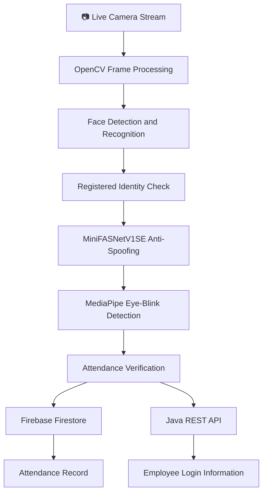

# 👁️ FaceGuard AI
### AI-Powered Face Recognition and Anti-Spoofing Attendance System

## 📌 Project Overview

FaceGuard AI is a Python-based attendance management system that combines face recognition, AI-based anti-spoofing, and eye-blink detection to automate employee attendance.

The system processes live camera footage, detects faces, compares them with registered employee images, and uses the **MiniFASNetV1SE anti-spoofing model obtained from the Hugging Face platform** to help distinguish genuine faces from spoofed presentations, such as photographs shown in front of a camera.

The application also uses MediaPipe facial landmarks to detect eye blinking as an additional verification step. When the implemented face recognition and verification conditions are satisfied, the system records attendance in Firebase Firestore and sends employee login information to a Java backend through a REST API.

This project demonstrates the integration of computer vision, deep learning inference, facial landmark analysis, cloud database services, and backend API communication in an automated attendance workflow.

## ✨ Key Features

- 👁️ **Face Detection:** Detects faces from camera frames using the `face_recognition` library.
- 🧑 **Face Recognition:** Identifies registered employees by comparing facial encodings.
- 🛡️ **AI-Based Anti-Spoofing:** Uses MiniFASNetV1SE to help identify spoofed face presentations.
- 🤗 **Hugging Face Model Integration:** Uses an anti-spoofing model associated with the Hugging Face model ecosystem.
- 👀 **Eye-Blink Detection:** Uses MediaPipe facial landmarks and the Eye Aspect Ratio method to detect blinking.
- 📷 **Live Camera Processing:** Processes video frames from a configured camera stream.
- 🗂️ **Registered Face Management:** Loads known face images from directories and associates them with employee names.
- ☁️ **Firebase Firestore Integration:** Stores employee attendance records and timestamps.
- 🔗 **Java REST API Integration:** Sends employee identification and login time to a backend service.
- 🔐 **Authentication and Token Management:** Retrieves and refreshes API authentication tokens.
- 📅 **Timestamp Recording:** Records the date and time when attendance is marked.
- 🖥️ **Real-Time Visual Feedback:** Displays recognized faces, verification messages, and attendance status on the video frame.
- ⚠️ **Error Handling:** Handles API communication failures and authentication-related errors.

## 🛠️ Technologies Used

- 🐍 **Python:** Main programming language used to develop the application.
- 👁️ **OpenCV:** Captures camera frames, resizes images, converts color formats, and displays recognition results.
- 🧑 **face_recognition:** Generates facial encodings and compares faces against registered identities.
- 🧠 **PyTorch:** Loads and runs the anti-spoofing neural network.
- 🛡️ **MiniFASNetV1SE:** Deep learning model used for face anti-spoofing classification.
- 🤗 **Hugging Face:** Platform for discovering and accessing pre-trained AI models suitable for different project requirements.
- 🔢 **NumPy:** Supports numerical operations and image processing.
- 👀 **MediaPipe Face Mesh:** Extracts facial landmarks for eye-blink analysis.
- 📐 **Eye Aspect Ratio:** Measures changes in eye geometry to help detect blinking.
- ☁️ **Firebase Admin SDK:** Connects the application to Firebase services.
- 🗄️ **Firebase Firestore:** Stores employee attendance information.
- 🔗 **Requests:** Sends HTTP requests to the Java backend.
- 📄 **YAML:** Stores application configuration, camera settings, API details, and token information.
- 🕒 **Datetime and Time:** Generates timestamps and supports scheduled token refresh.
- 🧵 **Threading:** Runs token refresh operations in the background.

## 🏗️ System Architecture

The following diagram illustrates the main attendance processing workflow.

## ⚙️ How the Application Works

1. **Configuration:** The application reads its settings from a YAML configuration file.
2. **Authentication:** It retrieves an authentication token from the Java backend and starts a background token refresh process.
3. **Firebase Initialization:** Firebase Admin SDK initializes the connection to Firestore using service account credentials.
4. **Face Registration:** The system loads registered employee images and generates facial encodings.
5. **Camera Initialization:** OpenCV opens the configured camera stream and reads video frames continuously.
6. **Face Recognition:** Detected faces are compared against the registered facial encodings.
7. **Anti-Spoofing:** The detected face is passed to the MiniFASNetV1SE model for classification.
8. **Eye-Blink Detection:** MediaPipe extracts facial landmarks, and the application calculates the Eye Aspect Ratio to detect blinking.
9. **Attendance Verification:** The application checks the face match, anti-spoofing result, and blink condition.
10. **Attendance Storage:** When the implemented verification conditions are satisfied, attendance information is saved to Firebase Firestore.
11. **Backend Communication:** The application sends the employee ID and login timestamp to the Java backend through a REST API.
12. **Visual Feedback:** OpenCV displays recognition and verification information on the camera frame.

The application continues processing camera frames until the stream ends or the user presses the Escape key.

## 🧑 Face Recognition Process

The system uses the `face_recognition` library to identify registered employees.

### Registration and Recognition Workflow

- Employee images are loaded from the configured image directory.
- Facial encodings are generated from images containing detectable faces.
- Directory names are used as employee names.
- Live camera frames are resized to reduce processing requirements.
- Facial encodings are extracted from detected faces.
- Euclidean distances are calculated between detected encodings and stored encodings.
- The closest match is selected when its distance is below the configured threshold of `0.5`.
- Faces without a sufficiently close match are classified as Unknown.

This process enables the application to identify registered employees from live camera footage.

## 🛡️ AI-Based Anti-Spoofing with MiniFASNetV1SE

FaceGuard AI uses the **MiniFASNetV1SE anti-spoofing model**, obtained through the Hugging Face model ecosystem, to analyze face images and help distinguish genuine faces from spoofed presentations.

Hugging Face provides a platform where developers can explore and access pre-trained AI models for different tasks, evaluate suitable models, and integrate compatible models into their applications.

### How the Model Is Used

- 📷 The application extracts a detected face from the camera frame.
- 🖼️ The face image is resized to `80 × 80` pixels.
- 🎨 The image is converted from BGR to RGB.
- 🧠 The image is converted into a PyTorch tensor and passed through the neural network.
- 📊 The model output is converted into probabilities using softmax.
- ✅ The application compares the probability at index `1` against a configured threshold of `0.4`.
- 🚫 When the check fails, the application displays a message indicating that a 2D fake face was detected.

The supplied model architecture includes convolutional layers, depthwise separable convolutions, batch normalization, PReLU activations, adaptive average pooling, and a classification layer.

### Hugging Face and Model Selection

Hugging Face provides access to a wide range of pre-trained models that developers can explore for computer vision, natural language processing, audio processing, and other AI applications.

For this project, MiniFASNetV1SE is used for anti-spoofing. Other compatible models can be evaluated based on project requirements, inference speed, available hardware, model compatibility, and validation results.

The supplied implementation loads model weights from a local PyTorch checkpoint file. It does not automatically download the model from Hugging Face or train the model.

## 👀 Eye-Blink Detection Using MediaPipe

The project uses MediaPipe Face Mesh to extract facial landmarks around the left and right eyes.

The Eye Aspect Ratio measures the relationship between vertical and horizontal distances between selected eye landmarks.

- 👀 MediaPipe extracts eye landmarks.
- 📐 The application calculates the Eye Aspect Ratio.
- 🔎 When the ratio falls below the configured threshold of `0.25`, the application sets the blink-detected flag.
- ✅ The blink condition is used as an additional verification step.

The code also defines instructions for turning the face right, turning the face left, and smiling. However, the supplied implementation does not independently validate those actions as separate conditions. Its active liveness-related logic uses eye-blink detection.

## ☁️ Firebase Firestore Integration

Firebase Firestore stores employee attendance information in a collection named Attendance.

When the implemented verification conditions are satisfied, the application creates an attendance record containing:

- **Name:** Recognized employee name.
- **Timestamp:** Date and time when attendance is recorded.
- **Attendance:** Attendance status, represented by `P` for present.

The Firebase Admin SDK connects the application to Firestore using a service account credentials file.

Firestore storage and Java backend communication are separate parts of the application. Firestore records attendance, while the Java API receives employee login information.

## 🔗 Java REST API Integration

The application communicates with a Java backend to submit employee login information.

### Information Sent to the Backend

- **Employee ID:** The identifier associated with the recognized employee.
- **Login Time:** The timestamp at which attendance is recorded.

The application includes an authentication token in the request headers and submits the data using an HTTP POST request.

It checks for HTTP status codes `200` and `201` to determine whether the Java API request was successful. Other responses and connection errors are reported in the terminal.

## 🔐 Authentication and Token Management

The project includes token retrieval and refresh functionality for the Java backend.

- The application sends configured authentication credentials to the authentication endpoint.
- It extracts the returned token when authentication succeeds.
- The token is stored in the YAML configuration file.
- A background thread triggers token refresh approximately every five minutes.
- The refreshed token is used for subsequent attendance API requests.

For production deployments, credentials and tokens should be stored securely using environment variables or a secrets management service rather than committed to a public repository.

## 💻 Installation and Setup

### Prerequisites

- Python installed in your development environment.
- A compatible camera or video stream.
- PyTorch and compatible MiniFASNetV1SE model weights.
- Registered employee face images.
- A configured Firebase project and Firestore database.
- Valid Java backend API endpoints and authentication credentials.
- Required Python libraries installed.

### Step 1: Prepare the Project

Download or clone the project repository and open it in your preferred Python development environment.

### Step 2: Install Dependencies

Install the libraries required by the implementation, including:

- OpenCV
- face_recognition
- NumPy
- PyTorch
- MediaPipe
- Firebase Admin SDK
- PyYAML
- Requests

Some packages, particularly `face_recognition`, may require additional system dependencies.

### Step 3: Configure the Application

Update the YAML configuration file with the required camera stream URL, Java API endpoints, authentication details, and other application settings.

The application also requires a Firebase service account credentials file.

### Step 4: Prepare the Face Recognition Dataset

Place registered employee images in the configured image directory. The directory structure should allow the application to associate each employee's images with the corresponding directory name.

### Step 5: Prepare the Anti-Spoofing Model

Place the compatible MiniFASNetV1SE PyTorch checkpoint at the file path expected by the application.

The supplied implementation loads the model weights locally.

### Step 6: Run the Application

Run the Python script after configuring the camera, model weights, Firebase credentials, and backend API.

The application will begin processing camera frames and displaying recognition and verification results.

## ⚠️ Error Handling

The application includes basic handling for:

- 🔐 Authentication failures and unauthorized API requests.
- 🌐 Network and HTTP request errors.
- 🧠 Anti-spoofing model loading and checkpoint compatibility issues.
- 📷 Camera stream failures.
- 🔗 Java backend API errors.
- ⚙️ Unexpected exceptions during token updates.

Additional validation and logging can further improve reliability and simplify troubleshooting.

## 🤖 AI Model Platform and Future Improvements

Hugging Face provides access to pre-trained AI models that developers can explore and select according to their project requirements.

In FaceGuard AI, MiniFASNetV1SE is integrated into the Python application using PyTorch to perform anti-spoofing inference on detected face images.

Potential improvements include:

- 🤗 Explore additional compatible anti-spoofing models available through Hugging Face.
- 🛡️ Evaluate models using genuine and spoofed face samples.
- 📊 Compare model accuracy, false acceptance rates, and false rejection rates.
- ⚡ Optimize inference speed for real-time camera processing.
- 👀 Extend liveness verification with additional facial movements and challenge-based checks.
- 🔐 Improve credential and token management.
- 🔄 Add automatic camera reconnection and better network handling.
- ☁️ Improve database error handling and attendance consistency.
- 🧪 Add automated tests for recognition, anti-spoofing, and attendance workflows.
- 🖥️ Develop a dashboard for employee registration and attendance reports.
- 📈 Add attendance analytics and reporting features.

## 🎯 Skills Demonstrated

- 🐍 Python programming.
- 👁️ Computer vision with OpenCV.
- 🧑 Face detection and recognition.
- 🔢 Facial encoding comparison and distance-based matching.
- 🧠 PyTorch neural network inference.
- 🛡️ MiniFASNetV1SE-based anti-spoofing.
- 🤗 Pre-trained AI model integration using the Hugging Face model ecosystem.
- 👀 MediaPipe facial landmark analysis.
- 📐 Eye Aspect Ratio calculations.
- ☁️ Firebase Firestore integration.
- 🔗 REST API integration.
- 🔐 Authentication and token management.
- 📄 YAML configuration management.
- 📷 Real-time video processing.
- 🧵 Background processing and threading.

## 📌 Conclusion

FaceGuard AI demonstrates the integration of face recognition, AI-based anti-spoofing, and eye-blink detection in an automated employee attendance system.

By combining MiniFASNetV1SE inference, facial encoding comparison, MediaPipe landmark analysis, Firebase Firestore, and Java REST API integration, the project provides a foundation for camera-based attendance automation with additional presentation attack checks.

The project showcases practical skills in computer vision, deep learning inference, real-time video processing, cloud database integration, and backend communication.

---

**Project Name:** FaceGuard AI

**Project Type:** AI-Powered Face Recognition and Anti-Spoofing Attendance System

**Primary Technologies:** Python, OpenCV, face_recognition, PyTorch, MiniFASNetV1SE, MediaPipe, Firebase Firestore, REST API, and YAML

**FaceGuard AI: Recognize. Verify. Record.**
